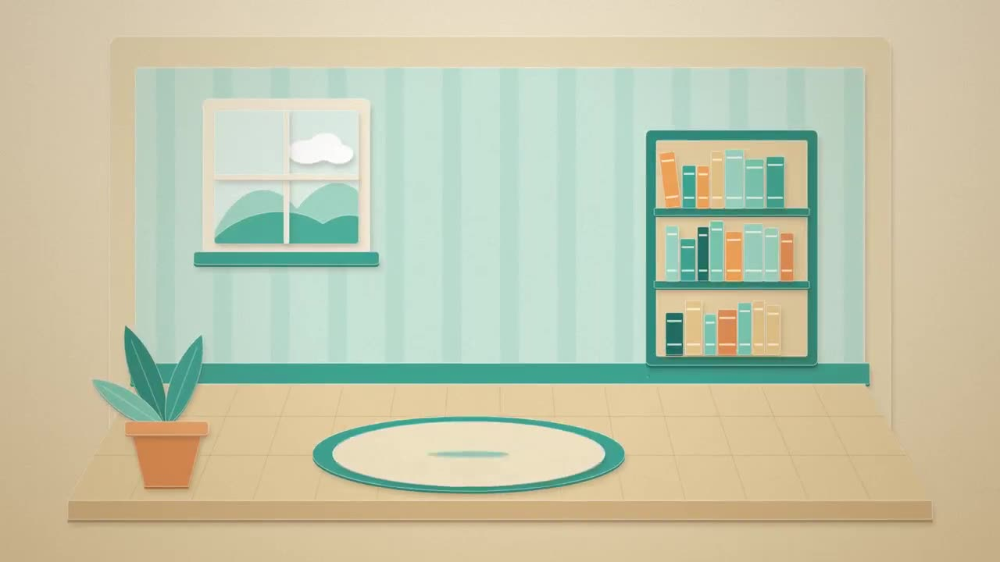
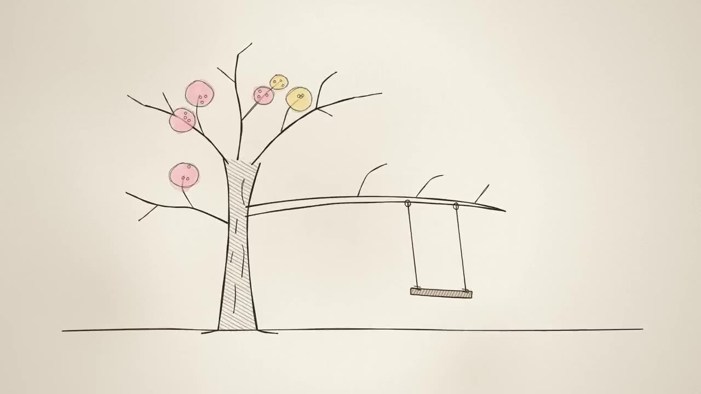
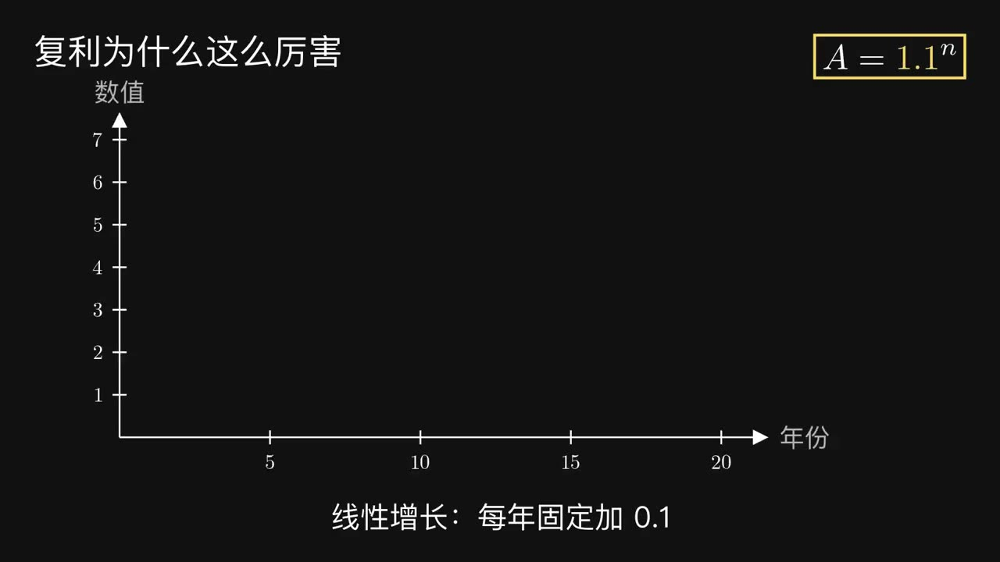
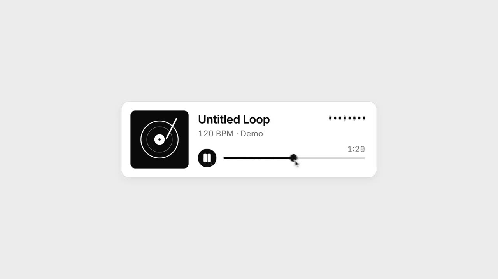
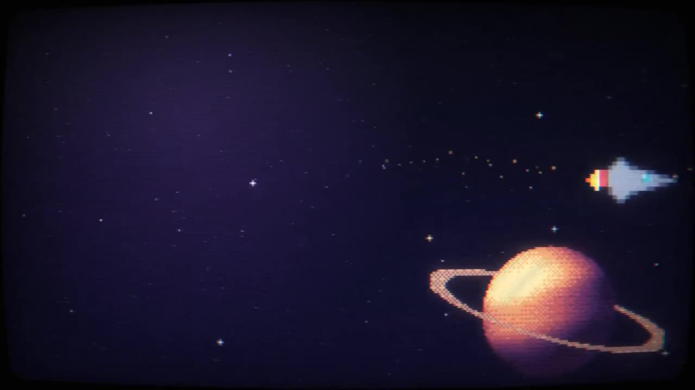
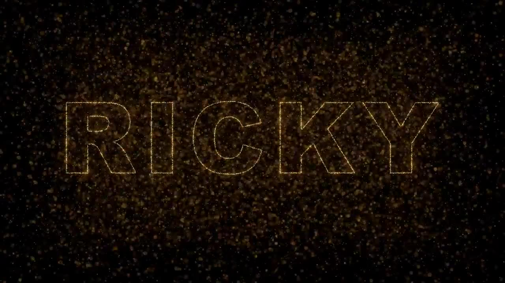
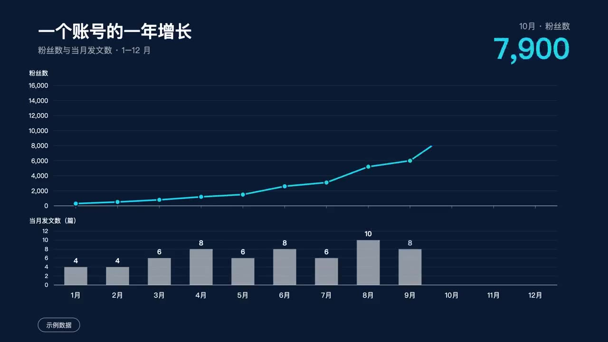

# Opus Code Animation

用 Claude Opus 5.5 写代码做动画视频的 Skill：14 种类型，每种都有工具、完整提示词和我自己做出来的演示视频。

Opus 5.5 本身不会生成视频。它的做法是先写一个程序，再由程序按时间画出每一帧，最后合成 MP4。这个 Skill 把选工具、写提示词、出分镜、渲染和自检这一整套流程固定下来，你只要说清楚想做什么。

## 14 种类型和演示视频

点缩略图看视频。

<table>
<tr><td align="center" width="25%"><a href="examples/demo-01.mp4"></a><br><b>1. 分层插画</b><br><sub>Canvas 2D</sub></td><td align="center" width="25%"><a href="examples/demo-02.mp4"></a><br><b>2. 手绘草图</b><br><sub>Rough.js</sub></td><td align="center" width="25%"><a href="examples/demo-03.mp4"></a><br><b>3. 水彩、水墨</b><br><sub>p5.js + p5.brush</sub></td><td align="center" width="25%"><a href="examples/demo-04.mp4"></a><br><b>4. 3D 场景</b><br><sub>Three.js</sub></td></tr>
<tr><td align="center" width="25%"><a href="examples/demo-05.mp4"></a><br><b>5. 板书动画</b><br><sub>Manim</sub></td><td align="center" width="25%"><a href="examples/demo-06.mp4"></a><br><b>6. 黏土质感</b><br><sub>Blender</sub></td><td align="center" width="25%"><a href="examples/demo-07.mp4"></a><br><b>7. 界面动效</b><br><sub>HyperFrames</sub></td><td align="center" width="25%"><a href="examples/demo-08.mp4"></a><br><b>8. 动态排版长片</b><br><sub>Remotion</sub></td></tr>
<tr><td align="center" width="25%"><a href="examples/demo-09.mp4"></a><br><b>9. 像素动画</b><br><sub>Canvas 2D</sub></td><td align="center" width="25%"><a href="examples/demo-10.mp4"></a><br><b>10. 复古质感</b><br><sub>WebGL 着色器</sub></td><td align="center" width="25%"><a href="examples/demo-11.mp4"></a><br><b>11. 粒子片头</b><br><sub>Three.js</sub></td><td align="center" width="25%"><a href="examples/demo-12.mp4"></a><br><b>12. 数据可视化</b><br><sub>D3</sub></td></tr>
<tr><td align="center" width="25%"><a href="examples/demo-13.mp4"></a><br><b>13. 线稿讲解</b><br><sub>Python + Pillow</sub></td><td align="center" width="25%"><a href="examples/demo-14.mp4"></a><br><b>14. 素材剪辑 + 动效</b><br><sub>video-use</sub></td></tr>
</table>

## 安装

在 Claude Code 里直接说：

```
帮我安装这个 Skill：https://github.com/rickyhu20/opus-code-animation
```

或者手动复制：

```bash
git clone https://github.com/rickyhu20/opus-code-animation.git
cp -r opus-code-animation/skills/opus-code-animation ~/.claude/skills/
```

## 需要的环境

- Claude Code，模型选 Opus 5.5，effort 调到 high 或以上
- Node.js、Chrome（或 Playwright 自带的 Chromium）、FFmpeg、Python 3
- 第 5 种还要 Manim 和 LaTeX，第 6 种还要 Blender

缺什么 Skill 会先检查，再告诉你要装什么。

## 怎么用

装好后直接说你想做什么，比如：

```
用代码动画做一条 15 秒的像素风片头，主角是一个巫师
```

```
把这篇文章做成 60 秒的竖屏知识视频，风格干净一点
```

```
我想做一个讲复利的公式动画，用什么工具好？
```

它会先帮你选类型，给出分镜让你确认，确认后再写代码、渲染成 `out/final.mp4`。

## 里面有什么

```
skills/opus-code-animation/
  SKILL.md                 流程、14 种类型速查表、硬规则
  references/
    prompt-logic.md        提示词的底层逻辑、7 个要素和通用结尾
    setup.md               环境准备、踩坑记录、局限和成本
    types/                 14 种类型，每种的效果、工具、做法和提示词
examples/                  14 个演示视频和缩略图
```

## 相关链接

- 完整图文版：[不会写代码，我用 AI 做出了 14 种代码动画](https://rickyhu.dev/#post-ai-code-animation-14-types)
- 参考资料：[opus-video-prompts](https://github.com/joeseesun/opus-video-prompts)、[xilo-opus-video](https://github.com/Kianzzz/xilo-opus-video)、[Lemo-Opuscar](https://github.com/lemomo-ai/lemo-opuscar)

文中用到的工具和开源项目，版权归各自作者所有。
